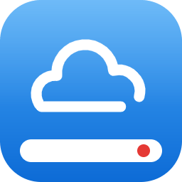

<div align="center">
  
  <h1>YuWangCloudSync</h1>
</div>

macOS 原生客户端（macOS 14+、Apple Silicon）。界面用 SwiftUI / AppKit，协议、缓存和离线队列用 C# / .NET 10。Windows 用于开发和测试后台引擎，Mac 构建原生界面。

## 功能

- 多账号、验证码、会话复用；Mac 凭据存入 Keychain。
- 共享盘与文件夹树后台递归预加载；原生目录树导航，实时加载子目录。
- 路径导航、当前目录筛选、排序、强制刷新；直链获取文件大小。
- 收藏按账号保存，收藏和路径跳转自动在导航栏定位。
- 原生行选择、⌘ 多选、Shift 连选，刷新保留已选项。
- 单文件、多文件、目录递归离线下载，以及独立导出。
- 选择文件或拖放上传，目录递归合并；同名文件可跳过、覆盖或改名。
- 双击编辑后自动回传，云端有并发修改时暂停。
- 新建目录、改名、同盘移动、回收站删除，可离线排队并按依赖执行。
- 存储上传记录、校验完整内容、中断续传，结果不明确时停止重传。
- 关闭窗口后驻留菜单栏，退出时保存队列。

## 数据与同步

Mac 数据位于 `~/Library/Application Support/YuWangSync`，缓存位于 `~/Library/Caches/YuWangSync`。

双击打开的副本受应用管理，保存后排队回传。主动离线下载是一次性快照，不跟踪后续云端更新。刷新重查云端列表，不覆盖本地编辑。

未完成任务、冲突和本地修改不会被缓存清理删除。上传前使用稳定文件快照。设置中“上传文件后下载校验”默认开启，“使用数据流量/热点时启用”默认关闭，网络类型由 macOS 费用标记识别。校验在空闲时下载文件并校验。

关闭下载校验时，新建、已完整确认且名称不变的上传可在大小核对后完成；覆盖、续传和结果不明确的上传仍保留为待校验。旧备份不提前回收，可在任务“更多”菜单选择“立即下载校验”。已发送但结果未知的任务会核对云端；取消任务不会撤销已发生的云端操作。规则详见 [架构与恢复规则](docs/ARCHITECTURE.md)。

## 开发

使用 .NET SDK 10.0.401。托管依赖和 osx-arm64 单文件发布依赖使用已提交的锁文件。

```powershell
dotnet restore YuWangSync.slnx --locked-mode
dotnet test YuWangSync.slnx -c Release --no-restore
dotnet run --project src/YuWangSync.Engine -- --smoke-test --output artifacts/engine-smoke.json
```

`open YuWangSync.app --args --demo` 进入演示模式，使用独立临时目录和内存模拟服务，不读取正式账号。正常启动在界面中填写服务器、账号和密码。

Mac 构建需要含 SwiftUI SDK 的 Xcode / 命令行工具，用于原生界面和 Keychain / NSFileCoordinator 桥接。无需 .NET macOS workload。

```bash
bash tools/package-macos.sh
```

输出 `artifacts/YuWangSync-macOS-arm64-1.0.0.zip` 和 `.dmg`，各附 SHA-256。ZIP 内为 `.app`；DMG 含应用与 Applications 链接。自带 .NET 运行时，仅使用自签名证书。签名与钥匙串规则见 [仓库签名](docs/signing/README.md)。

开源许可见 [开源组件](docs/THIRD-PARTY-NOTICES.md)。

## 许可

协议代码从 Windows 项目的 `3d14869bd1627e2389ade276b73babc4247f3bfe` 移植，见 [移植来源](docs/PORTING.md)，适用 [MIT 许可证](LICENSE)。
